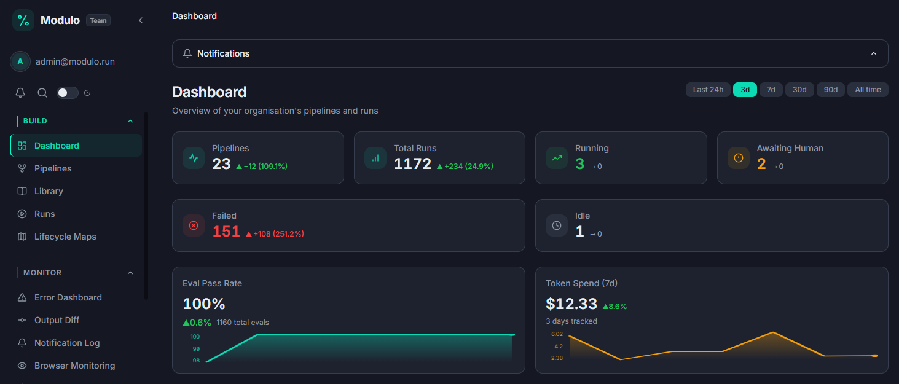

# Farna Control

<div align="center" style="background: #0F1A1B; border-radius: 16px; padding: 40px 24px; margin-bottom: 24px;">
  
  <p style="margin: 0; color: #E8ECEF; font-size: 1.1rem; line-height: 1.6;">
    Farna Control is a self-hosted Delivery Governance Platform. Govern the software development lifecycle as AI and automation take on more of the work — recording, evaluating, controlling, and improving automated work across your SDLC.
  </p>
</div>


<p align="center">
  <a href="https://github.com/farnalabs/farna-control/actions"></a>
  <a href="LICENSE"></a>
  <a href="https://farna.dev/control/docs"></a>
  <a href="https://app.modulo.run"></a>
</p>

<p align="center">
  <a href="https://sonarcloud.io/dashboard?id=farnalabs_modulo-new"></a>
  <a href="https://sonarcloud.io/dashboard?id=farnalabs_modulo-new"></a>
  <a href="https://sonarcloud.io/dashboard?id=farnalabs_modulo-new"></a>
  <a href="https://sonarcloud.io/dashboard?id=farnalabs_modulo-new"></a>
  <a href="https://sonarcloud.io/dashboard?id=farnalabs_modulo-new"></a>
  <a href="https://sonarcloud.io/dashboard?id=farnalabs_modulo-new"></a>
  <a href="https://sonarcloud.io/dashboard?id=farnalabs_modulo-new"></a>
  <a href="https://sonarcloud.io/dashboard?id=farnalabs_modulo-new"></a>
</p>

<p align="center">
  
</p>

> [!WARNING]
> **Alpha software.** Farna Control is under active development. Interfaces,
> database migrations, configuration, and deployment procedures may change.
> Evaluate it before using it with production data and keep current backups.

## Table of Contents
- [What it is](#what-it-is)
- [Core concepts](#core-concepts)
  - [How this works with existing agents in practice](#how-this-works-with-existing-agents-in-practice)
- [Key features](#key-features)
- [Quick start (five-minute demo)](#quick-start-five-minute-demo)
- [Documentation](#documentation)
- [Architecture](#architecture)
- [Development and testing](#development-and-testing)
- [Contributing](#contributing)
- [Security](#security)
- [License](#license)

## What it is

Farna Control is a Delivery Governance Platform you own and run. It records, evaluates, controls, and improves automated work across the software development lifecycle — including code, dependencies and licensing, security, release, documentation and knowledge, evidence, and remediation — while keeping execution, approvals, audit data, and credentials under the operator's control.

The operating loop is **record → evaluate → control → improve**: capture what automated work did, assess its outputs and evidence, apply gates and human decisions where needed, then use the results to improve the delivery system. Issue-to-PR is one governed workflow in that system, not the whole product. The platform is not generic workflow automation, primarily governance of agent internals, or a prescriptive software factory; software-factory language is only a supporting implementation frame.

In the current product, you wire AI agents into your tools inside a visual pipeline where every run is audited and budgeted, and can be gated on human approval — so AI-assisted delivery is repeatable and auditable, not a one-off experiment.

The detailed product intent and delivery status live in the product roadmap.
Items described there may be planned or partially delivered; check the relevant
documentation and tests before relying on a capability.

## Core concepts

**Pipelines.** Farna Control is a visual, composable pipeline of atomic AI
agents — agent, manual, and approval (human-in-the-loop gate) nodes, with
conditional routing and parallel fan-out — that automates work between your
existing tools. Runs are executed, evaluated, and audited.

**Bring your own agent runtime.** Agents run in an agentic sandbox platform of
your choice (for example E2B, a cloud sandbox platform for AI agents, or local
Docker). Farna Control dispatches work to the sandbox, collects the structured
output, and owns the governance around it: auth, audit, cost tracking, and
evaluation gates.

**Schemas everywhere.** Each stage you configure can declare typed JSON
Schemas for its input and output. Schemas define the contracts between
stages, can be inferred from your connected tools, are checked at run time
where set, and migrate between versions.

**Everything is versioned.** Pipelines are snapshotted at run time, schemas and
agent prompts are versioned, and every action is written to an audit trail, so
you can see exactly what ran and with what inputs.

**Triggers and approvals.** Manual, webhook, and scheduled triggers start
runs; approval nodes pause a run at a gate until a human approves or rejects
it.

### How this works with existing agents in practice

Modulo connects to existing agents without requiring any agent rewrite:

- **No agent rewrites:** You do not import our SDK or wrap your agents in our framework classes.
- **Two execution shapes:**
  1. **Container or CLI execution (Docker, Kubernetes pod, E2B sandbox):** Modulo provisions the environment, passes parameters/context via CLI args or environment variables, runs the command, and monitors stdout, exit code, and output artifacts.
  2. **CI/CD dispatch (GitHub Actions, GitLab CI, CircleCI, webhooks):** Modulo triggers the existing job, passes the payload, and waits for completion.
- **Standard unix I/O contract:** Inputs in via CLI arguments, environment variables, or JSON payload; output out via exit code (0 = success) and structured output / artifacts (diff, PR, or JSON). If an agent can run in a terminal or a CI pipeline, Modulo can govern it.

## Key features

- A visual pipeline editor and reusable pipeline templates
- Agent, manual, and approval nodes, with conditional routing and parallel fan-out
- Run history, evaluation, cost controls, and observability integrations
- Role-based access controls, audit trails, single sign-on (SSO), and feature licensing
- Extensible model backends, connectors, Model Context Protocol (MCP) tools, and runtime providers
- PostgreSQL 16 as the primary database, with conformance support for SQLite and MariaDB/MySQL

## Quick start (five-minute demo)

The shortest local evaluation uses Docker Desktop and Docker Compose:

```bash
git clone https://github.com/farnalabs/farna-control.git
cd farna-control
# Generate the credential-encryption key ONCE, before the first start.
printf 'FERNET_KEY=%s\n' "$(openssl rand -base64 32)" > .env
docker compose up -d
```

`FERNET_KEY` encrypts every stored credential (model backends, connectors). It
must be a real Fernet key — url-safe base64 of exactly 32 bytes — so it can
never be a fixed value in the Compose file. Compose refuses to start without
it and prints the generation command, rather than starting a stack that boots,
lets you sign in, and then fails the first time you save a credential.

On Windows PowerShell, generate the key with
`python -c "from cryptography.fernet import Fernet; print(Fernet.generate_key().decode())"`
and write it to `.env` as `FERNET_KEY=<value>`.

Keep `.env`: it is gitignored, and a different key on a later start makes the
credentials already stored in the database unreadable.

The first run builds the backend and frontend images and may take a few
minutes; after that, the demo itself takes about five minutes.

After the services become healthy, open <http://localhost:5173> and sign in
with the local demo credentials `admin` / `admin`. These credentials and the
Compose secrets are for local evaluation only.

To prove the stack can actually store a credential and initialize the
checkpointer — the two things a healthy-looking stack can still be broken at —
run the smoke check:

```bash
./scripts/smoke-compose.sh
```

The Compose stack includes PostgreSQL and Redis. Redis is required for pipeline
execution and scheduled triggers — it is started automatically by
`docker compose up -d`.

For a development setup with the API and frontend running outside containers,
follow the [quick-start guide](docs/quickstart.md). The full setup requires
Python 3.12, [uv](https://docs.astral.sh/uv/), Node.js 20+, and Docker Desktop.

**Next steps.** The [quick-start guide](docs/quickstart.md) covers local setup
and login. To run a first pipeline you will need to:

- connect a model backend,
- bring an agentic sandbox platform (for example E2B) or use a local runtime,
- define the schemas for your stages,
- trigger a run.

The [configuration reference](docs/configuration-reference.md) documents the
server-side environment variables, and [agent-config.md](docs/agent-config.md)
covers pipeline graph and node configuration.

## Native install (Linux and macOS)

The native single-install path is for workstation and evaluation use. Linux
uses the published `scripts/install.sh` bundle path. macOS signed and notarized
`.dmg` artifacts are published by release when available; the current
`bundle-v0.3.325` release includes Apple Silicon (`macos-arm64`) only, and does
not include an Intel (`macos-x86_64`) artifact. Rosetta is not required for the
published Apple Silicon artifact. Check the public [installation
documentation](https://farna.dev/control/docs/installation) and the release assets for
current platform availability, requirements, and installation steps.

Docker Compose remains the supported path for self-hosted server and production
use. Start with the [system requirements](docs/system-requirements.md), then
follow the [deployment guide](docs/deployment.md). Native Windows installation
is Beta scope and is not a supported Alpha installation path.


## Documentation

- [Quick start](docs/quickstart.md)
- [Architecture](docs/architecture.md)
- [Configuration reference](docs/configuration-reference.md)
- [Agent configuration](docs/agent-config.md)
- [Deployment guide](docs/deployment.md)
- [Continuity and escrow](docs/continuity-and-escrow.md)
- [System requirements](docs/system-requirements.md)
- [Troubleshooting](docs/troubleshooting.md)
- [Get support](docs/support.md)
- [Upgrade process](docs/upgrade-process.md)

## Architecture

| Area | Technology |
|---|---|
| API | Python 3.12, FastAPI, SQLAlchemy, Alembic |
| Agent orchestration | LangGraph and provider-specific LangChain packages |
| Web application | Vue 3, TypeScript, Pinia, Vite |
| Data services | PostgreSQL 16 and Redis 8 |
| Local deployment | Docker Compose |
| Quality tooling | pytest, Vitest, Ruff, mypy, ESLint, Semgrep, Bandit |

## Development and testing

Install and check each application from its own directory:

```bash
cd backend
uv sync --frozen
uv run pytest tests/unit tests/architecture
uv run ruff check .

cd ../frontend
pnpm install --frozen-lockfile
pnpm run lint
pnpm run type-check
pnpm run test:unit
```

The repository also contains integration, multi-database, browser, security,
and container suites. Some require local services or deployment credentials
and therefore do not run on every pull request. See
[CONTRIBUTING.md](CONTRIBUTING.md) for the current test suite inventory and
prerequisites.

## Contributing

Read [CONTRIBUTING.md](CONTRIBUTING.md) before opening a pull request. Farna
Control is alpha software, so focused changes with tests and documentation are
easiest to review. Use GitHub issues for reproducible bugs and scoped feature
proposals.

## Security

Do not report vulnerabilities in a public issue. Use GitHub's private **Report a vulnerability** flow or email `security@farna.dev` with reproduction details. See [SECURITY.md](SECURITY.md).

## License

Farna Control is licensed under the [Business Source License 1.1](LICENSE).
Production use of Farna Control is permitted, including personal, internal and
commercial use, for Farna Control itself and for any modified version or
derivative work you create, except offering Farna Control or such a version to
third parties as a paid hosted or managed service that provides substantially
the same functionality as Farna Control. Each release converts to the Apache
License 2.0 on its stated Change Date, three years after release.
